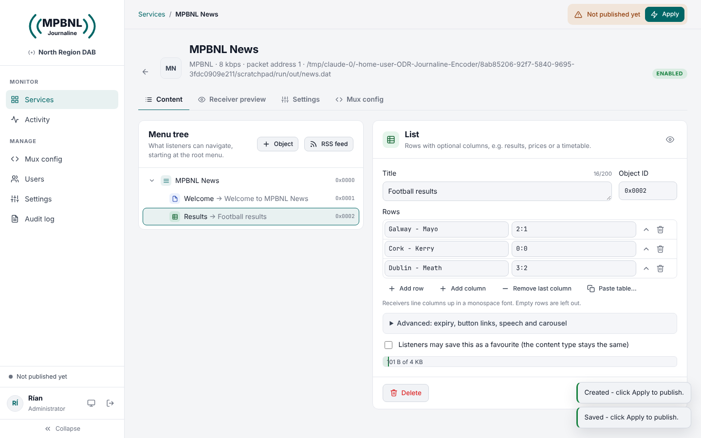
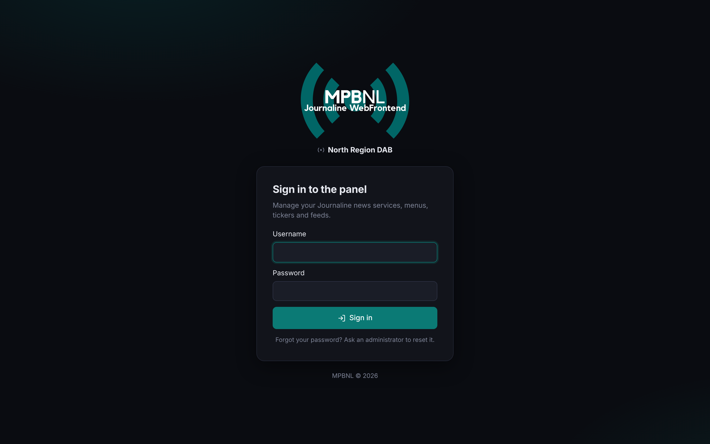
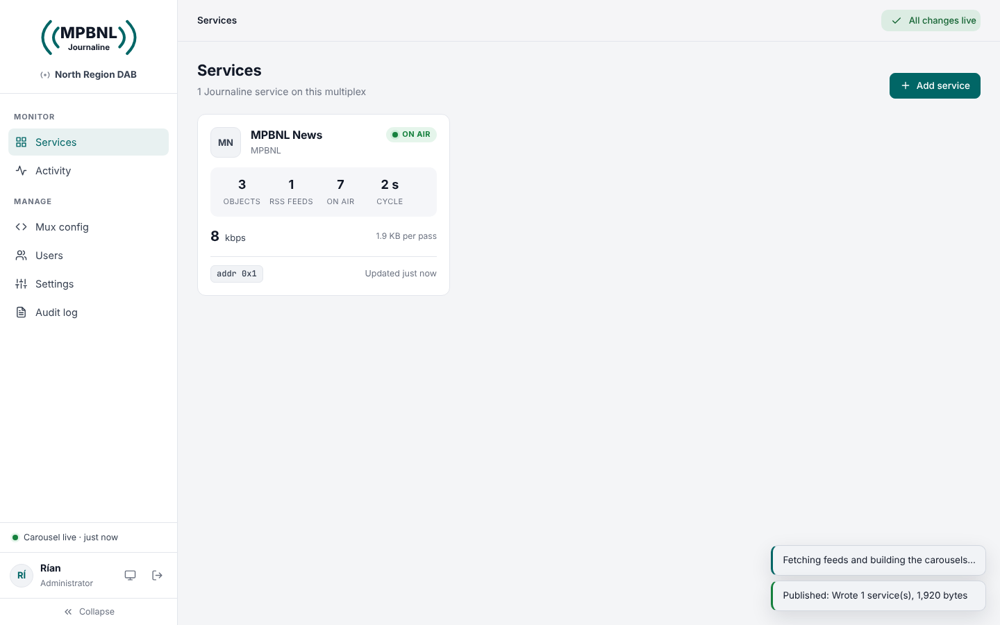
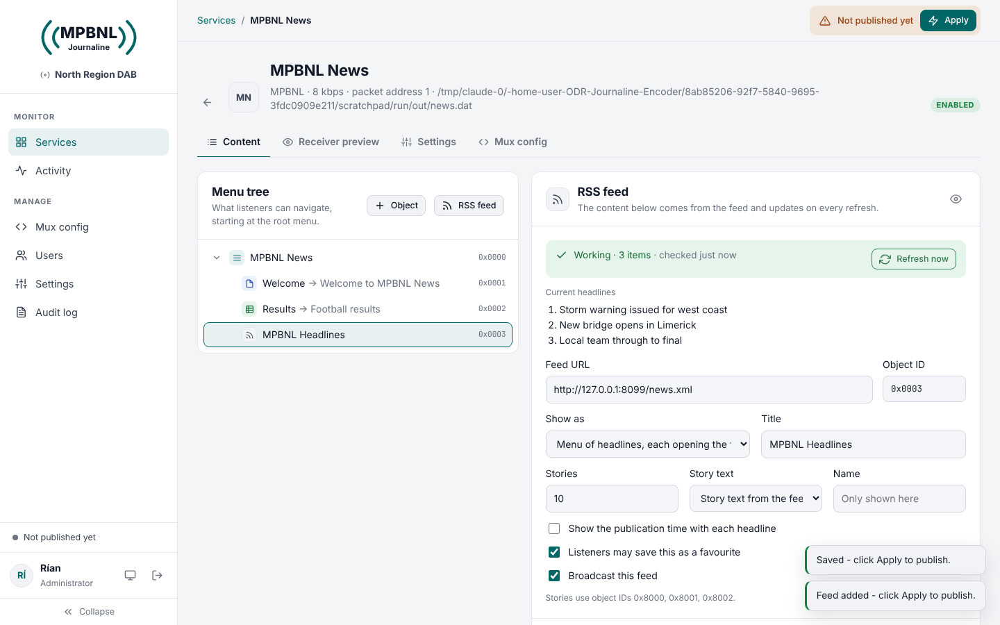
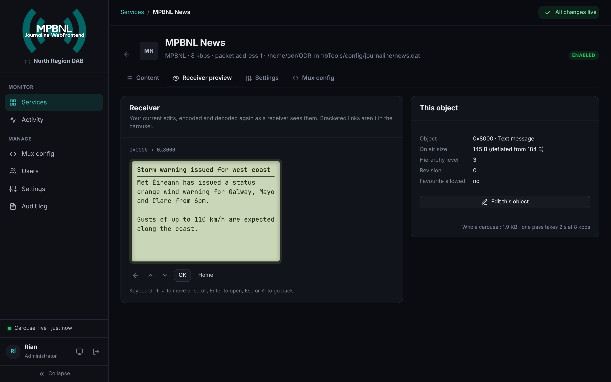
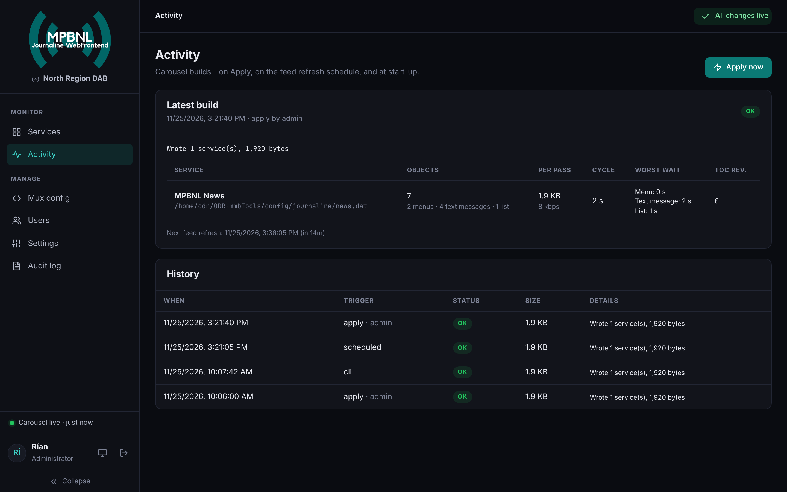
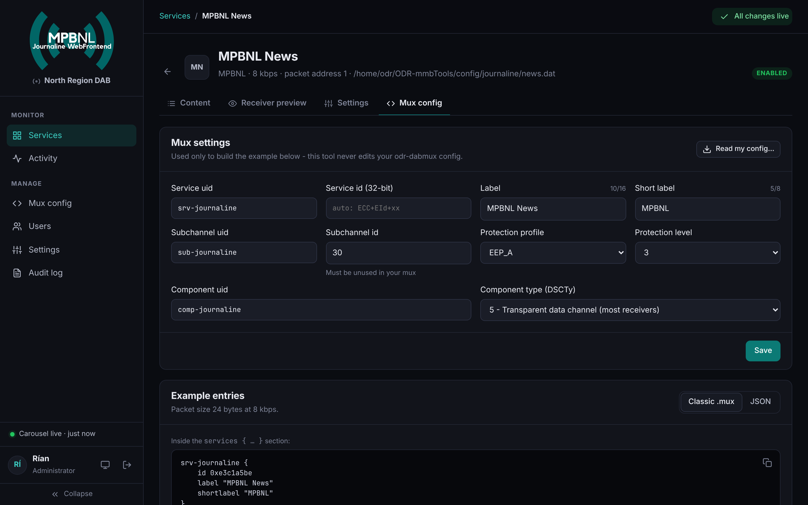

# MPBNL Journaline WebFrontend

A self-hosted **DAB Journaline® encoder** for [OpenDigitalRadio](https://github.com/Opendigitalradio/) multiplexes, with a web UI. Journaline is the text information service specified in **ETSI TS 102 979**: listeners browse menus of news, tickers, results and other text on their radio, similar to teletext.

It runs as a **systemd service**, builds each Journaline service as a packet-mode `.dat` carousel that ODR-DabMux reads, and keeps it up to date on its own. It uses the same design and install process as the [MPBNL SPI WebFrontend](https://github.com/ryanginn/ODR-SPI-Generator).



- **Several services per multiplex.** Each Journaline service has its own subchannel, packet address and output file, so two providers can share a mux.
- **Menu tree editor** for all four object types: **menus**, **text messages**, **tickers** (title-only messages) and **lists** (tables). Lists can be pasted straight from a spreadsheet.
- **RSS and Atom feeds** become a menu of headlines with the full stories, a ticker with the latest headline, or a list of headlines. They update on a schedule without anyone clicking Apply.
- **Receiver preview**: your unpublished edits are encoded and decoded again, then shown on a simulated receiver screen you can navigate.
- **The full spec**: deflate compression, the TOC, revision indexes, highlights, end-of-intro markers, timeouts (absolute and relative), "hot button" links (web, phone, SMS, DAB URI, other objects), language for text-to-speech, and location data.
- **Weighted carousel**: menus and tickers repeat more often than long messages, so navigation feels quick. The Activity page shows the cycle time and worst-case wait for each object type.
- **Mux config helper** in both formats ODR-DabMux reads, **classic `.mux`** and **JSON**, and it can read your existing config (either format) to pick up the ensemble ids and a free subchannel id.
- **Admins and editors**, an audit log, light and dark themes, and one-click updates.
- **Pure Python encoder** with no extra dependencies. Its output has been checked against the Fraunhofer IIS Journaline decoder (see [Testing](#testing)).

---

## Install

Tested target: **Debian 12 / Ubuntu 22.04+ / Raspberry Pi OS (bookworm)** with systemd and Python ≥ 3.9.

```bash
git clone https://github.com/ryanginn/ODR-Journaline-Encoder.git
cd ODR-Journaline-Encoder
sudo ./install.sh
```

The installer asks for the web UI port (default **8091**, so it can run next to the SPI WebFrontend on 8090), the listen address, and the user to run as (`odr` if it exists). That user must be able to **write the folder you pick for the output files**. Non-interactive: `sudo ./install.sh --yes --port 8091 --bind 0.0.0.0 --user odr`.

When it finishes, it prints the address to open, including a one-time **setup token** (shown again with `sudo odr-journaline-encoder setup-token`).

### First-run setup



1. **Create the administrator** with the setup token.
2. **Your multiplex**: a name for the panel and the ensemble ECC/EId. *Read from odr-dabmux config…* fills them in from a `.mux` or `.json` file.
3. **Your first Journaline service**: name, output file, bitrate (8 kbps is plenty for most text services) and packet address.
4. **Mux config**: copy the entries (classic or JSON) into your odr-dabmux config and restart it.
5. The service starts with a main menu and a welcome message. Build it out, check the **Receiver preview**, and click **Apply**.

### Upgrade / uninstall

```bash
sudo odr-journaline-encoder-update check   # or: apply (also under Settings → Updates)
git pull && sudo ./install.sh              # manual upgrade, keeps config + data
sudo ./uninstall.sh                        # removes the service, keeps /etc and /var/lib data
sudo ./uninstall.sh --purge                # removes everything (not your .dat files)
```

---

## Using it

### Services



A **service** is one Journaline data service on the multiplex: one packet-mode subchannel, one component with `userapp "journaline"`, and one `.dat` file. Add a second service when a second provider (or a second, separate news service) shares the mux. Each service has its own menu tree, feeds, bitrate, packet address and mux settings.

### The menu tree

Receivers start at the **root object, `0x0000`**, normally the main menu. Each menu holds **1 to 32 links**, and the tree may be at most **20 levels** deep. The tree on the *Content* tab shows what listeners can reach. Objects that aren't linked from any menu are listed underneath, and problems are marked in red (errors, which block publishing) or amber (warnings).

| Type | Use | Notes |
| :-- | :-- | :-- |
| **Menu** | Links to sub-menus and messages | Links can point anywhere, including back to the main menu. |
| **Text message** | A headline and a story | New lines become preferred line breaks, `**text**` is highlighted, and a line with only `---` ends the introduction (receivers and text-to-speech may stop there). |
| **Ticker** | One headline that updates on screen immediately | Ideal for breaking news or "now playing". |
| **List** | Rows and columns, e.g. results, prices or departures | Receivers line columns up in a monospace font. *Paste table…* takes spreadsheet or CSV data. |

Every object is limited to **4 092 bytes** before compression. The editor shows how full it is and refuses to save an object that is too large. Under *Advanced* you can set an **expiry time** (the object is taken off air and receivers hide it), a **lifetime after reception**, **button links**, the **language** for text-to-speech, how often it **repeats** in the carousel, and compression.

**Reorganising:** drag objects and feeds in the tree. Drop one onto a menu to put it inside, or between two links to reorder. Hold **Alt** (Option on a Mac) while dropping to add another link instead of moving it, and drop a link on *Not linked from any menu* to remove it from its menu. Each editor also has an **In menus** box listing where the object is linked from, with *Move to…*, remove and *Add to menu…*; use it on touch screens, where dragging isn't available.

Object IDs are assigned automatically (`0x0001` up) and can be changed. Links follow the change. Tick **favourite** on content that will always live at the same ID (e.g. "Sport headlines") so listeners can bookmark it.

### RSS and Atom feeds



*RSS feed* on the Content tab adds a feed as an object in the tree:

- **Menu of headlines**: one link per story, each opening a text message with the story (HTML is turned into plain text). Stories keep the same object ID while they stay in the feed, using IDs from `0x8000` up.
- **Ticker**: the latest headline.
- **List**: one headline per row, optionally with the time.

Feeds are re-read on every **Apply** and every *n* minutes (*Settings → Feeds and refresh*, default 15). The scheduled refresh rebuilds every carousel from the **last applied** state, so new stories go on air without anyone clicking Apply, and half-finished edits are never published by the timer. If a feed fails, the last good stories are kept and the failure shows on the service card and in Activity.

### Receiver preview



The *Receiver preview* tab encodes your current, unpublished state exactly as it would be broadcast, decodes it again and shows it on a simulated receiver. Use ↑ ↓ Enter and Esc or the buttons. Links in [brackets] point to objects that aren't in the carousel. The side panel shows each object's on-air size, compression, revision and hierarchy level.

### Apply and the carousel



Edits are saved immediately but **published only on Apply**. Each service is encoded on its own. If one has errors, the others are still written, and the Activity page says which one failed and why.

Each pass of the carousel contains every object, with menus (and the root menu) and tickers repeated more often than text messages. The repeats can be set per service (*Settings → Repeats per cycle*) and per object. A **TOC** (table of contents) is sent too, so receivers can drop removed objects from their cache. The Activity page shows each service's cycle time and the worst-case wait for each object type at its bitrate.

Revision indexes are tracked across builds: an object's revision only changes when its broadcast content changes, so receivers don't redraw unchanged pages.

### ODR-DabMux configuration



The *Mux config* tab (per service) and page (all services) give you the entries for your odr-dabmux config, in **classic `.mux`** or **JSON** format:

```text
services {
    srv-journaline {
        id 0xe3c1a5be
        label "MPBNL News"
        shortlabel "MPBNL"
    }
}
subchannels {
    sub-journaline {
        type packet
        bitrate 8
        id 30
        protection-profile EEP_A
        protection 3
        inputproto file
        inputuri "/home/odr/ODR-mmbTools/config/journaline.dat"
    }
}
components {
    comp-journaline {
        type 5
        service srv-journaline
        subchannel sub-journaline
        user-applications {
            userapp "journaline"
        }
        address 0x1
        datagroup true
    }
}
```

- `userapp "journaline"` makes ODR-DabMux signal user application type 0x44A with the user application data TS 102 979 requires (version 0, no extended header).
- `type 5` (transparent data channel) is what most Journaline receivers look for. 44 is offered for newer receivers.
- `datagroup true` is required: Journaline is carried in MSC data groups.
- **Attaching to your audio stations** (*Where listeners find it* on the Mux config tab): Journaline can be its own data service (its own entry in the station list), attached to one or more audio stations, or both. An attached station gets an extra component that points at the same Journaline subchannel, so receivers offer the news while someone listens to that station, and the data is only sent once. Pick the stations from your config (*Read my config…*) or type their service uid. Put each extra component after that station's audio component in your config, so the audio stays its primary component.
- The data service id is 32-bit: `ECC + EId + 2 hex digits`. Read your config (`.mux` or `.json`) and the ECC/EId and a free subchannel id are filled in.
- The packet size follows the bitrate, as in the SPI WebFrontend: the largest packet that fits a whole number of times into each 24 ms frame.
- The output file is **rewritten in place** by default, because ODR-DabMux keeps the file open and rewinds it.

### Users

| Role | Can do |
| :-- | :-- |
| **Administrator** | Everything: users, settings, server file browser, audit log |
| **Editor** | All services, their content and feeds, mux settings; can Apply |

---

## HTTPS

Same as the SPI WebFrontend: set `tls_cert`/`tls_key` in `/etc/odr-journaline-encoder/config.json`, or install with `--bind 127.0.0.1`, set `"behind_proxy": true` and put it behind a reverse proxy.

## Command line

```
sudo odr-journaline-encoder setup-token          # show the first-run setup token
sudo odr-journaline-encoder reset-password NAME  # temporary password for a user
sudo odr-journaline-encoder build                # refresh feeds and rebuild from the last applied state
systemctl status odr-journaline-encoder
journalctl -u odr-journaline-encoder -f
```

## Files

| Path | Contents |
| :-- | :-- |
| `/opt/odr-journaline-encoder` | Application and its Python virtualenv |
| `/etc/odr-journaline-encoder/config.json` | Port, listen address, TLS, data directory |
| `/var/lib/odr-journaline-encoder` | SQLite database (services, objects, feed cache) |
| *(your choice)* | One `.dat` output file per service |

## Security

See [SECURITY.md](SECURITY.md).

## Development

```bash
python3 -m venv .venv && .venv/bin/pip install -e .
ODR_JML_DATA_DIR=./data ODR_JML_PORT=8091 .venv/bin/odr-journaline-encoder serve
.venv/bin/python -m unittest discover -s tests -t .
```

The encoder lives in `odr_jml/encoder/`:

| Module | Spec |
| :-- | :-- |
| `jml.py` | JML objects: header, content section, escape sequences, data sections, deflate (TS 102 979 §5) |
| `toc.py` | TOC management data blocks (§6.2) |
| `msc.py` | MSC data groups (§8.1.1) and DAB packet mode (EN 300 401 §5.3.2) |
| `service.py` | Validation (§4.3, §5), revision tracking and the weighted carousel |
| `decode.py` | An independent decoder used by the receiver preview and the tests |

### Testing

`tests/test_encoder.py` checks the encoder against the coding examples in the spec, the round trip through the decoder, the TOC, data group and packet layers, and the carousel. `tests/test_api.py` drives the web API end to end, including feeds served from a local HTTP server and two services on one mux.

To check the output against a real receiver implementation, `tools/decoder-check` builds a small command-line wrapper around the **Fraunhofer IIS NewsService Journaline decoder** (using the copy in Qt-DAB):

```bash
tools/decoder-check/build.sh                         # needs git, g++ and zlib1g-dev
tools/decoder-check/check.py /path/to/journaline.dat # prints every object it decodes
JML_DECODER=tools/decoder-check/build/jml-decode python3 -m unittest tests.test_encoder
```

Qt-DAB's copy of that decoder marks text messages and tickers `valid=0` even when it decodes them correctly (it returns before setting the flag), so check the title and items it prints.

---

### Credits

- **Fraunhofer IIS**: Journaline® and its reference decoder, used to verify the output
- **Opendigitalradio**: [ODR-mmbTools and ODR-DabMux](https://github.com/Opendigitalradio)
- **Jan van Katwijk**: [Qt-DAB](https://github.com/JvanKatwijk/qt-dab), whose copy of the Fraunhofer decoder the test tool uses
- **Rían Mac Fhionnghaile**: MPBNL Journaline WebFrontend and the MPBNL SPI WebFrontend it is built from

Journaline® is a registered trademark of Fraunhofer IIS.

### License

GNU General Public License v3.0 (GPLv3). See [LICENSE](LICENSE).
